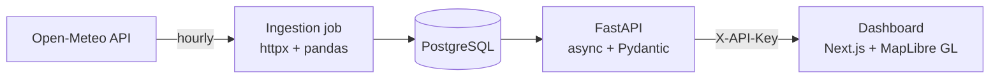

# HeatWatch Global

Heat monitoring for major world cities, with expanded coverage across the United States and Europe. The FastAPI service ingests hourly temperature, humidity, wind speed and wind direction, computes heat-index metrics, and serves them through an authenticated REST API and a searchable Next.js + MapLibre GL dashboard.

## Architecture



## Quick start

```bash
cp .env.example .env
docker compose up --build -d
docker compose run --rm ingest          # seeds the global city set and pulls recent weather
curl -H "X-API-Key: dev-key" http://localhost:8000/rankings/hottest
```

Interactive docs: http://localhost:8000/docs

## Dashboard

```bash
cd frontend
cp .env.example .env.local   # server-side only: API URL and key
npm install
npm run dev                  # http://localhost:3000
```

The browser never sees the API key. Requests go through a small Next.js proxy (`src/app/api/[...path]/route.ts`) that attaches it server-side and only forwards the read-only routes below. Basemaps come from CARTO's free vector styles, so check their terms before using the demo commercially.

## API

All routes except `/health` need an `X-API-Key` header.

| Route | Description |
|---|---|
| `GET /cities` | Tracked cities |
| `GET /cities/{slug}/temperature?from=&to=&limit=` | Hourly readings with heat index and risk category |
| `GET /cities/{slug}/heat-summary?days=7` | Current conditions, daily min/max/mean, anomaly |
| `GET /rankings/hottest?hours=24&limit=10` | Cities ranked by peak heat index |
| `GET /health` | Liveness check |

Heat index uses the US NWS Rothfusz regression; risk bands follow NWS categories. Timestamps are UTC.

## Develop and test

```bash
cd backend
python -m venv .venv && source .venv/bin/activate
pip install -r requirements-dev.txt
pytest
```

Tests run against in-memory SQLite, so no database is needed.

## Deploy on AWS EC2

The production deployment runs Caddy, Next.js, FastAPI, PostgreSQL, and hourly
weather ingestion as a private Docker Compose stack. Only Caddy publishes ports
80 and 443. See [`deploy/README.md`](deploy/README.md) for the EC2, HTTPS,
secrets, persistence, backup, and update instructions.

## Roadmap

- [x] Ingestion pipeline, heat metrics, authenticated API, tests, Docker, CI
- [x] Dashboard: Next.js + MapLibre GL map + ECharts trend chart
- [ ] Redis caching on ranking and summary endpoints
- [ ] Alembic migrations
- [ ] Historical backfill (Open-Meteo archive) for a real climate baseline
- [x] Single-instance AWS EC2 deployment package
- [ ] Managed multi-instance deployment with ECS and RDS
